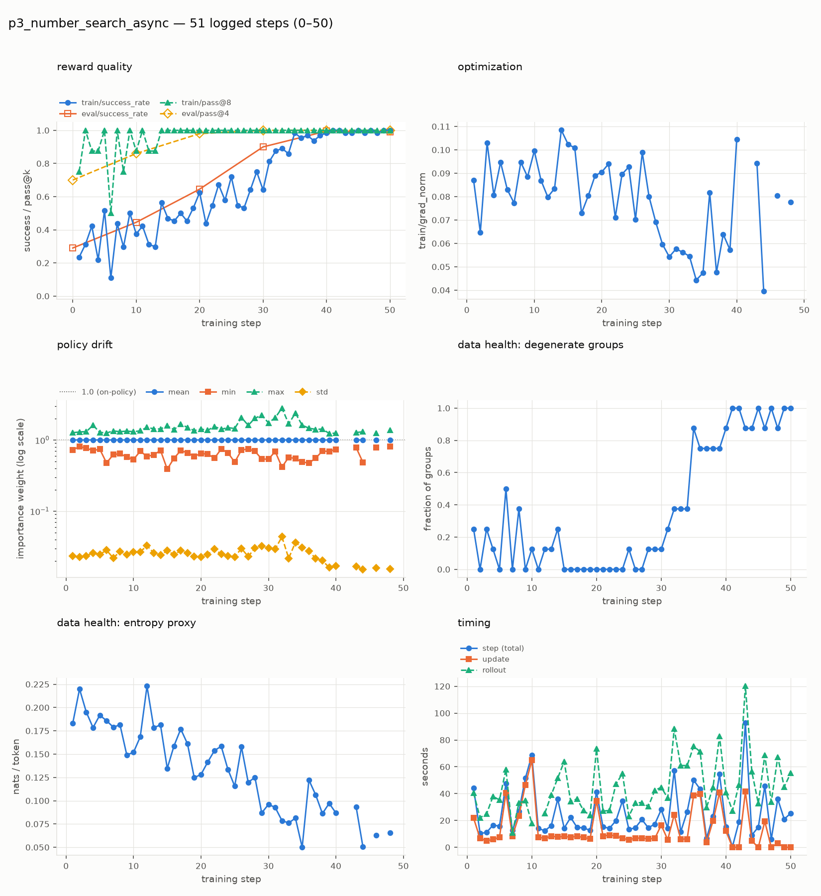
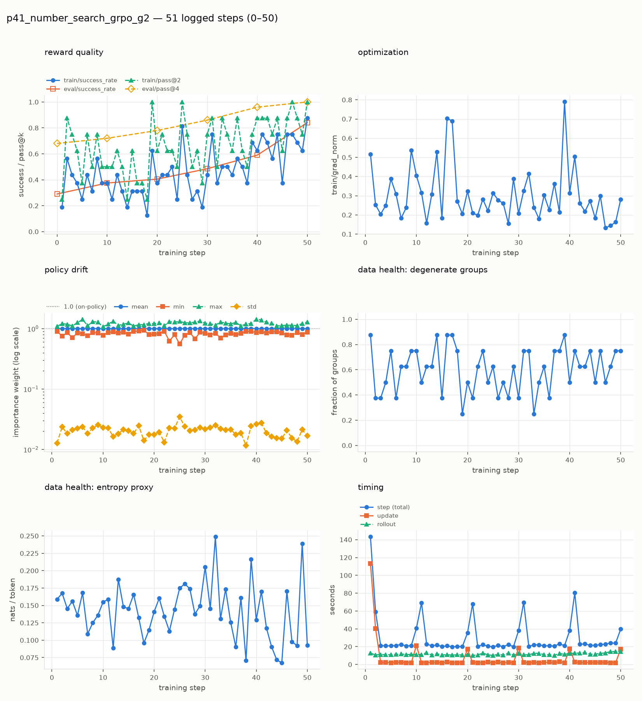
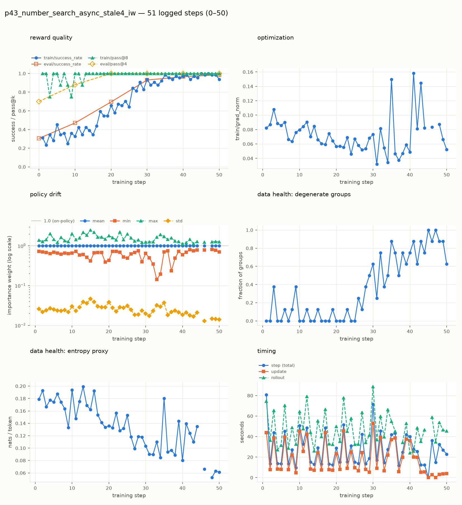
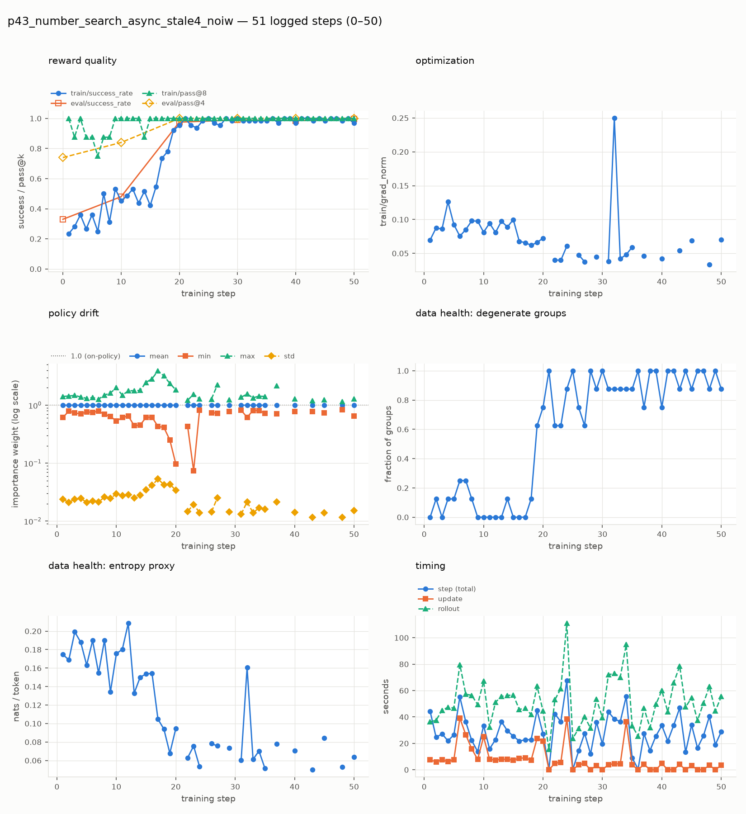
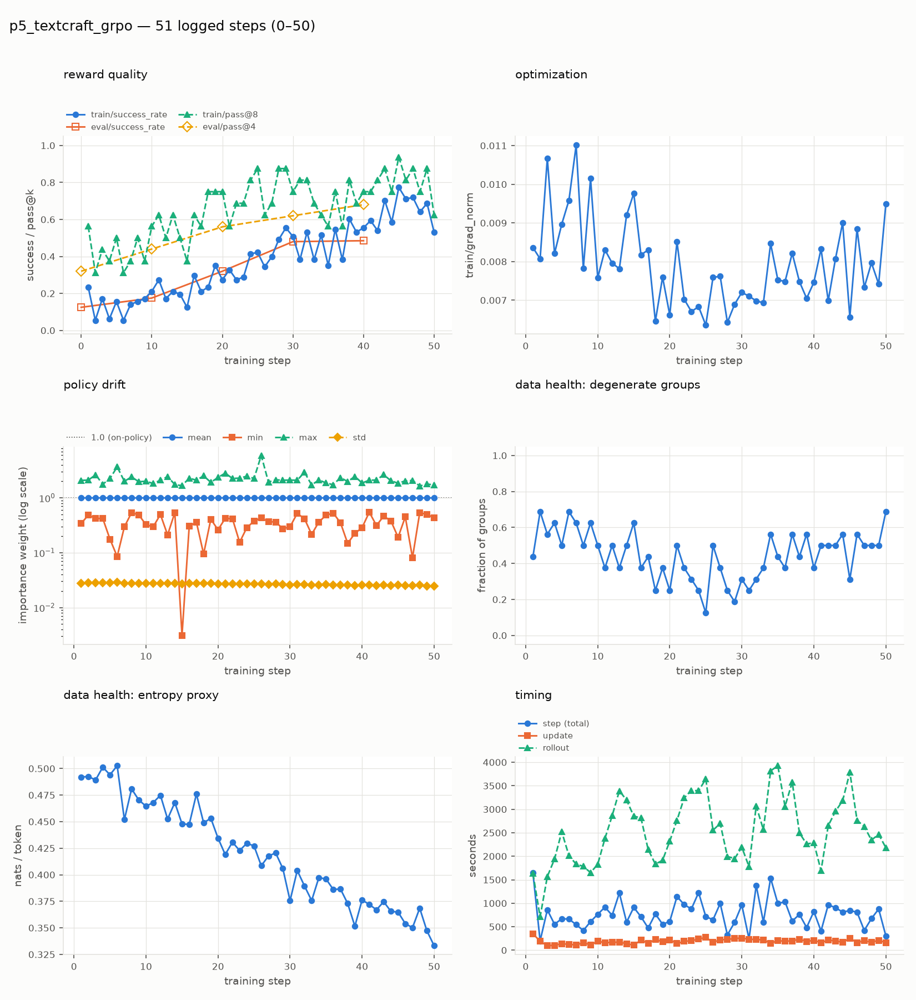

# scottyrl — Assignment 3 Report

**11-768 AI Agents, CMU, Fall 2026.**

*This report is written to be read by a generalist: every section states what was
done, shows the evidence (plots/tables), and explains what the evidence means in
plain terms before drawing conclusions.*

---

## Part 2: Synchronous REINFORCE and GRPO

### What we built and why

The trainer alternates two phases. First it **collects rollouts**: the agent
plays the task against the environment, one episode per task, using the current
policy. Then it **updates** the policy from those episodes and refreshes the
sampling policy so the next batch is on-policy.

The same loop implements both algorithms; the only difference in the advantage
computation is one line of math that decides how much each episode is worth:

- **REINFORCE** (`p2a`, 1 rollout per task) uses the raw episode reward as the
  advantage: $A = r$. A success is reinforced, a failure contributes nothing.
  It is unbiased but noisy, because every task is judged on a single coin flip.
- **GRPO** (`p2b`, 8 rollouts per task) compares each rollout to the other
  rollouts of the *same task*: $A_i = r_i - \frac{1}{G}\sum_k r_k$. The group
  mean acts as a baseline, so easy and hard tasks cancel out and only
  "better than my usual attempt" is reinforced. When all $G$ rewards are
  identical there is no signal at all; we call that a *degenerate* group and skip
  it entirely. Following Dr.GRPO we do not divide by the group's standard
  deviation, which avoids up-weighting changes on tasks where the policy is
  nearly deterministic.

The token-level mask matters as much as the advantage: only tokens the policy
itself sampled are trained on, so the model learns to *act* rather than to
predict the environment's replies.

### Setup

Both runs use the provided configs unchanged, on the `serve_number_search_sync`
deployment: Qwen3.5-4B with a rank-32 LoRA adapter, 50 steps, 8 tasks
per step, and an evaluation every 10 steps on 50 held-out tasks with 4 rollouts
each. `p2a` uses the unclipped `importance_sampling` loss; `p2b` uses clipped
`ppo`. Because GRPO skips degenerate groups, only 31 of `p2b`'s 50 steps
actually update the weights (see the degeneracy discussion below). A 10-step
probe run was done first and checked out (real transcripts, importance weights
≈ 1.0, no sanity warnings).

### Results

Every panel below plots a metric against training step, as the handout
specifies. Each pass@ curve is labelled with its exact logged key, because
training and evaluation use different values of *k* and are different
quantities.

#### p2a — REINFORCE (1 rollout per task)


#### p2b — GRPO (8 rollouts per task)


#### Side by side


| | p2a REINFORCE (G=1) | p2b GRPO (G=8) |
|---|---|---|
| Eval success rate, step 0 → 50 | 0.34 → 0.455 (peak 0.465 at step 40) | 0.42 → 0.995 |
| Eval success rate at step 10 | 0.32 | 0.925 |
| Eval `pass@4`, step 0 → 50 | 0.78 → 0.84 | 0.84 → 1.00 |
| Train success rate, steps 40–49 mean | 0.54 | 0.99 |
| Mean `train/grad_norm` | 0.357 | 0.074 |
| `train/entropy_proxy`, first → last step | 0.195 → 0.180 | 0.155 → 0.102 |
| Steps with nothing to train on | 0 of 50 | 19 of 50 (all rewards identical) |
| Mean importance weight | 1.000 | 1.000 |
| Wall-clock for 50 steps | 21.5 min | 35.0 min |

### What the evidence means

**The pipeline is correct.** In both runs the importance weight *mean* sits
within ±0.002 of 1.0 at every step (the `mean` curve in each drift plot). That
is the fingerprint of synchronous on-policy training: every batch was sampled by
the very policy that then trained on it. The tails confirm it — the per-step
minimum and maximum stay within roughly 0.53–1.48 (`p2a`) and 0.55–2.29 (`p2b`),
the ordinary spread of a single sampling draw, and the per-step std stays
between 0.013 and 0.032. In the asynchronous Part 3 run those tails widen
measurably, which is the contrast that makes this diagnostic worth plotting. If
sampled log-probabilities were attached to the wrong tokens, the mean would
drift away from 1.0; it does not, so this is the cleanest available check that
the masking and log-prob alignment work. No episodes were abandoned in either
run. Neither run had a batch with no tokens to train on, though `p2a` step 35 is
a batch with nothing to *learn* from: every episode in it failed, so the
advantage was uniformly zero and the step produced no gradient.

**GRPO learns much faster and much further.** It goes from 42% to 92.5% held-out
success in the first 10 steps and reaches ~99% by step 20, while REINFORCE only
creeps from 34% to a peak of 46.5% at step 40 before slipping back to 45.5% at
step 50. The train-time curves agree: GRPO's mean train success rate in the
last ten steps is 0.99, versus 0.54 for REINFORCE, whose batch-to-batch train
success still ranges from 0.0 to 0.875. Note that `pass@4` for
REINFORCE (0.84) is far above its `success_rate` (0.455): the policy *can*
solve the task, it just does so unreliably, which is exactly the variance a
baseline is supposed to remove.

**Is that difference expected? Yes, and for a concrete reason.** In Number
Search a task is either solved or not, so a reward is 0 or 1. Under REINFORCE
the advantage is that sparse number itself, so a failed episode contributes no
gradient at all, and a successful one is reinforced regardless of whether the
policy usually solves that task already. GRPO instead uses the other seven
rollouts on the *same* task as a control. A hard task where one rollout in eight
succeeds produces one strongly positive and seven negative advantages, whereas
an easy task where all eight succeed produces none. The estimator is therefore
far less noisy at the same number of update steps — it spends its gradient
budget where there is still something to learn. This is the textbook motivation
for GRPO, and the handout predicts it.

**Two secondary observations.** First, GRPO's gradient norm is much smaller
(0.074 vs 0.357) and its entropy proxy falls further (0.155 → 0.102). The smaller
gradient is expected because centering removes the large positive rewards that
dominate an uncentered REINFORCE gradient; the sharper entropy drop is the
policy becoming confident as it masters the task. Second, GRPO's efficiency
shows up as *degeneracy*, not as a bug: the degenerate fraction first reaches
1.0 at step 17, and from then on a typical step has all eight groups with all
eight rollouts succeeding, so they are correctly skipped. 19 of 50 steps have no
training examples at all. That is the
expected end state once a task is solved — there is simply nothing left to learn
from it — and it also means the late `p2b` eval plateau at ~99% is real rather
than a stalled run. The `[sanity]` warnings the framework printed about
degenerate groups are therefore benign here; they would be a real problem only
if they appeared *early*, before the task was solved.

**Cost.** GRPO costs about 1.6× more wall-clock per step here (35 vs 21.5 min for
50 steps) because it samples eight times as many episodes per task. Averaged over
all 50 steps it logs 4,739 action tokens per step against REINFORCE's 845, a 5.6×
increase — but that understates the ratio, because 19 of those GRPO steps trained
on zero tokens. Restricted to the 31 steps that actually updated the weights,
GRPO averages 7,644 action tokens per step, a 9.0× increase over REINFORCE. That
is *above* 8×, since a solved GRPO episode needs extra turns to finish. It is
still the better buy: it reaches in 10 steps a success rate REINFORCE never
approaches in 50.

---

## Part 3: Asynchronous GRPO

### What we built and why

The synchronous trainer wastes a lot of time. In `p2b` the learner spends 68% of
every step **idle**, waiting for rollouts to finish: with 8 tasks × 8 rollouts
per step, the sampler works for ~23 s while the trainer sits still, then the
trainer works for ~4 s while the sampler sits still.

The asynchronous trainer breaks that alternation into a pipeline. Eight
**rollout workers** continuously generate groups and push them into a bounded
queue; the **learner** pulls groups off the queue, updates, and publishes a new
policy version. Training and sampling now happen at the same time, on separate
GPUs.

The price is that a group may be generated by a policy a version or two behind
the one now being trained. Two mechanisms handle that:

- **Staleness bound.** Each result carries the policy version that produced it.
  The learner checks `current_version − group_version` *when it consumes the
  group* and discards anything staler than `max_staleness = 2`.
- **Importance weighting.** Accepted off-policy data is reweighted by
  $\rho = \pi_\text{new}(a \mid s) / \pi_\text{old}(a \mid s)$, and the `ppo`
  loss clips that ratio so a single badly-weighted token cannot dominate a
  batch.

Two correctness details matter for the design. Every group takes **one**
`(policy, version)` pair captured before its first rollout, so a publish that
happens mid-group cannot mislabel it. And evaluation is scheduled as a
**background task** on a captured pair, so a slow evaluation never stalls the
learner.

### Setup

The provided config runs unchanged on the `serve_number_search_async`
deployment (2×H100, **split** — one GPU trains, one samples, unlike Part 2's
colocated server). It matches `p2b` exactly except for the concurrency: 8 groups
of 8 rollouts per step, 50 steps, `max_staleness = 2`, queue capacity 16, and
the clipped `ppo` loss. A 6-step probe at full width was run first and checked
out: exactly 48 groups consumed for 6 steps, 8 stale drops, importance weights
at 1.000, and `learner_wait_frac` already down to 0.01.

The run finished with `{'train_steps': 50, 'groups_consumed': 400,
'groups_dropped_stale': 36}`, also written to the last record of
`runs/p3_number_search_async.jsonl` as `summary/*`.

### Results



| | p2b GRPO sync | p3 GRPO async |
|---|---|---|
| Eval success rate, step 0 → 50 | 0.42 → 0.995 | 0.29 → 0.99 |
| Eval success rate at step 20 | 0.99 | 0.645 |
| Eval `pass@4`, step 0 → 50 | 0.84 → 1.00 | 0.70 → 1.00 |
| Train success rate, steps 40–49 mean | 0.99 | 0.99 |
| Mean `train/grad_norm` | 0.074 | 0.079 |
| `train/entropy_proxy`, first → last | 0.155 → 0.102 | 0.183 → 0.065 |
| Steps with nothing to train on | 19 of 50 | 6 of 50 |
| Importance weight — mean | 1.000 | 1.000 (0.9992–1.0007) |
| Importance weight — min | 0.549 | 0.389 |
| Importance weight — max | 2.287 | 2.802 |
| Importance weight — std | 0.016 (0.013–0.023) | 0.025 (0.015–0.044) |
| `learner_wait_frac` (median, updating steps) | 0.68 | 0.21 |
| `learner_wait_frac` (median, all steps) | 0.71 | 0.27 |
| Wall-clock for 50 steps (first to last record) | 35.0 min | 22.4 min |

**Importance weights need to be read as a distribution, not a mean.** The mean
`ρ` stays within ±0.001 of 1.0 across the 44 updating steps (0.9992–1.0007),
which looks like perfectly on-policy data — and the mean nearly hides the truth. The tails say otherwise:
the **minimum** `ρ` per step averages 0.63 and reaches **0.389**, while the
**maximum** averages 1.53 and reaches **2.80**. In other words, in the worst
step some individual token was 2.6× *less* likely under the training policy
than under the policy that sampled it (1/0.389), and another up to 2.8× more
likely. That is exactly
what one expects from a 1–2-version lag: the policy has moved a little, and a
few token-level ratios move a lot. The mean stays at 1 because for every token
pushed up another is pushed down. The per-step **std** (median 0.025) is the
honest summary of the spread, and min/max bound it.

This is also why the clipped `ppo` loss is the right choice here rather than
plain `importance_sampling`: a maximum ratio of 2.8 would give that token 2.8×
its gradient weight with no ceiling. The spread is also visibly wider than
synchronous `p2b`'s (min 0.389 vs 0.549, max 2.80 vs 2.29, std 0.025 vs 0.016),
as it must be: `p2b` is strictly on-policy apart from ordinary sampling noise.
The drift panel shows all four moments; note that the `mean` curve is visually
indistinguishable from the dotted 1.0 reference, which is precisely the point
that the mean alone is uninformative.

**Learning.** The async run reaches the same place more slowly per update: 0.29
→ 0.99 held-out success, but it gets to 0.645 at step 20 where `p2b` was already
at 0.99. Two things explain that, and neither is a bug. First, `p3` starts lower
(0.29 vs 0.42 baseline) — the initial policy snapshotted by a different server
is simply a bit weaker. Second, 8.3% of all generated groups (36 of 436) were
discarded as stale, so the learner sees somewhat less fresh data per step. It
still finishes at 0.99 with `pass@4 = 1.00`, and 6 skipped steps versus `p2b`'s
19 shows it stays useful later into the run. Note the last training record
reports `train/policy_version = 44`, not 50: six skipped steps meant the policy
advanced 44 times over 50 iterations, which is the documented step-versus-version
lag and a good check that the accounting is right.

**Speed.** The overlap works. Median `learner_wait_frac` falls from **0.68 to
0.21** over the steps that actually update — the learner spends 21% of a step
waiting instead of 68%. (Counting all 50 steps, the medians are 0.71 and 0.27;
`p3`'s six skipped steps are steps 41, 42, 45, 47, 49 and 50, scattered rather
than trailing, and on every one of them `learner_wait_frac` is exactly 1.0 —
the learner waited the whole step. Counting them as zero-wait would flatter the
overlap claim, so the updating-step figure is the honest one.) Total wall-clock
for the same
50 steps drops from 35.0 to 22.4 minutes, a **1.6× speedup**. Measured per
*update*, which is the fairer unit because `p2b` had 31 updates and `p3` had 44,
it is 67.8 s → 30.6 s, a **2.2× speedup**.

The per-update number understates the architectural win and the total number
overstates it, so both are reported. The reason `p3` is not 3–4× faster overall
is visible in the timing panel: an async update is *slower* (7.9 s median over
updating steps vs 4.0 s) because the async server trains on **one** GPU while
the colocated sync server trains on **two**. Async buys overlap and pays for it
with half the training hardware — which is the trade the deployment makes by
design, and the reason `serve_number_search_async.py` exists as a separate
server.

### How the agent's behavior changed

Three training transcripts, one from each third of the run. Headers are quoted
from the first line of each `.jsonl` file.

**Early — step 5, `number_search.train.35`, `policy_version=2`, reward 0.0**
(range 93–1023, target 1010):

```
t0 guess(558) too low    t1 guess(790) too low    t2 guess(906) too low
t3 guess(964) too low    t4 guess(991) too low    t5 guess(1002) too low
t6 guess(1011) too high  t7 guess(1006) too low   t8 guess(1009) too low
t9  "I have used all 10 guesses..."  → no tool call (out of steps)
```

**Middle — step 25, `number_search.train.226`, `policy_version=23`, reward 0.0**
(range 44–630, target 84):

```
t0 337 too high   t1 190 too high   t2 118 too high   t3  75 too low
t4 141 too high ← outside the surviving interval [76,117]
t5 108 too high   t6  95 too high   t7  90 too high   t8  80 too low
t9  85 too high (out of steps)
```

**Late — step 45, `number_search.train.391`, `policy_version=40`, reward 1.0**
(range 36–927, target 154):

```
t0 481 too high  t1 258 too high  t2 146 too low   t3 202 too high
t4 174 too high  t5 160 too high  t6 153 too low   t7 156 too high
t8 154  Correct!
```

Three concrete changes, each also measurable across the whole run:

1. **From scanning to bisecting.** The early transcript only ever moves uphill
   (558, 790, 906, 964, 991, 1002) and burns eight guesses getting within 90 of
   the answer. The late one halves the interval each turn. To measure this
   across every logged transcript, each `guess(n)` is scored by its distance
   from the midpoint of the interval still consistent with the feedback so far,
   divided by that interval's width. The score is 0 for a perfect bisection, 0.5
   for a guess at an endpoint, and 0.25 on average for a blind guess. Taking the
   median over all guesses in one step's directory, it falls from **0.145 at
   step 5 to 0.001 at step 45**. The policy learned the algorithm, not just the
   format. (Recompute from `runs/p3_number_search_async_trajectories/`: replay
   each episode's feedback to get the interval, then take the median of
   `|n - mid| / width` over the `guess` calls in each `step_NNNNNN/`.)

2. **It stops repeating itself.** At step 5, 6.5% of guesses were a number the
   agent had already guessed in that episode and been told the answer to. That
   falls to 3.5% by step 15, 1.6% by step 25, 0.55% by step 30, and **0.0%** at
   steps 35, 40 and 45. Re-asking a question you already have the answer to is
   pure waste, and the run learns to stop doing it.

3. **It recovers from its own mistakes — unevenly.** The middle transcript guesses
   141, which the feedback already ruled out (after `118 is too high` and
   `75 is too low` the surviving interval is [76, 117]). It immediately returns
   to the interval with 108 and keeps narrowing. Not all eight rollouts of that
   group do as well: one of them, after `82 is too low`, guesses 77, 80, 79, 81
   and 82 again — all below the interval [83, 92] — and never recovers, and one
   other spends its last guess just outside an interval that has already
   collapsed to a single value. The early agent handles this worse still: when
   it runs out of steps it ignores the format entirely and writes a sentence,
   which is rejected as unparseable. Note that unparsed output is rare at every
   stage (at most 1.2% of turns), so this is a recovery story, not a
   formatting-collapse story.

The `policy_version` in the headers is worth a glance. A step directory is
filled by whatever training rollouts *finish* during that iteration, and with
eight workers each captures its policy pair at the top of its own group. So a
publish landing while several groups are in flight splits one directory across
versions: step 5 holds 1 episode at version 2, 53 at version 3 and 14 at
version 4. That is the async behaviour working as intended — each group
correctly reports the version that actually generated it, and the version a
group carries is fixed at its start even when a publish happens midway through
its own eight rollouts.

---

## Part 4: Group Size, Synchrony, and Staleness

### 4.1 Group size

**Setup.** `p41` is `p2b` with `group_size: 2` instead of 8, on the same
`serve_number_search_sync` deployment and the same 50-step / 8-tasks-per-step
schedule. Everything else — the GRPO advantage, the clipped `ppo` loss, the
learning rate, the seed — is identical, so this is a clean group-size
comparison. Adding `p2a` (`G=1`, REINFORCE) gives the low end, with the caveat
the handout flags: `p2a` also changes the advantage rule and loss, so the
G=1-to-G=2 gap is not a pure group-size effect.



| | p2a REINFORCE (G=1) | p41 GRPO (G=2) | p2b GRPO (G=8) |
|---|---|---|---|
| Eval success rate, step 0 → 50 | 0.34 → 0.455 | 0.29 → 0.84 | 0.42 → 0.995 |
| Eval success rate at step 20 | 0.40 | 0.405 | 0.99 |
| Eval `pass@4`, step 0 → 50 | 0.78 → 0.84 | 0.68 → 1.00 | 0.84 → 1.00 |
| Train success rate, steps 40–49 mean | 0.54 | 0.66 | 0.99 |
| `frac_degenerate_groups`, mean / last 10 steps | N/A | 0.60 / 0.66 | 0.73 / 0.93 |
| Steps with every group degenerate | N/A | 0 of 50 | 19 of 50 |
| Mean sequences per step | 8.0 | 6.4 | 17.1 |
| Mean `\|advantage\|` | — | 0.500 | 0.290 |
| `adv_std` | 0.446 | 0.489 | 0.374 |
| Mean `train/grad_norm` | 0.357 | 0.306 | 0.074 |
| `train/entropy_proxy`, first → last step | 0.195 → 0.180 | 0.159 → 0.092 | 0.155 → 0.102 |
| Wall-clock for 50 steps (first training record to last) | 21.5 min | 22.9 min | 35.0 min |

`p41`'s figure is first training record to last training record. Its step-0
evaluation ran before the first update and its step-50 evaluation was recovered
separately hours later (see below), so neither is inside the training window.

`frac_degenerate_groups` is N/A for `p2a` in the table rather than the 0 the
run logs: with one rollout per task there is no group baseline, so a group can
never be "degenerate" and the logged value carries no information.

**What a smaller group does to the advantages.** With G=2 and a binary reward
there are only two outcomes per group, and one of them — both rollouts agree —
tells the learner nothing. When the two differ, the two advantages are `+0.5`
and `−0.5`; when they agree, both are 0. So `|A|` is *always* exactly 0.5 or
exactly 0, and the run's mean `|A|` of 0.500 (over the kept tokens of all steps,
mixed and degenerate alike, since degenerate *groups* are dropped from the
batch) is arithmetic, not a measurement. With G=8 a mixed group with `k`
successes spreads advantages from `(8−k)/8` down to `−k/8`, so the grid is
finer and every mixed group contains magnitudes as small as `1/8`; the mean
`|A|` over the kept tokens falls to 0.290. A small group therefore trades *resolution* for
*swing*: the surviving advantages are larger in magnitude but there are fewer
of them and they are always the same two values, so the per-step gradient is
coarser and noisier. `adv_std` shows the difference plainly — 0.489 for `p41`
versus 0.374 for `p2b`.

**The degenerate fraction does not behave the way "small groups are noisy"
would suggest.** `p41`'s degenerate fraction is *lower* than `p2b`'s — 0.60
against 0.73 on average, and 0.66 against 0.93 over the last ten steps. The
reason is that the two runs fail in opposite regimes. `p2b` saturates: once it
solves the task, all eight rollouts succeed and the group is degenerate, so a
*succeeded* step is an *unusable* step. By the last ten steps it is degenerate
93% of the time and 19 of its 50 steps update nothing at all. `p41` never gets
that good, so its two rollouts keep disagreeing — it has **no fully-degenerate
step**, and its worst step is 0.875 (7 of 8 groups) rather than 1.0. The
number to read alongside the fraction is the one it costs: 6.4 sequences per
step versus 17.1. Even where `p41` is less degenerate, it produces less data
per step, because 8 tasks × 2 rollouts is 16 rollouts at most against 8 × 8 =
64.

**What it costs in learning.** `p41` finishes at 0.84 held-out success
(`pass@4 = 1.00`) against `p2b`'s 0.995, and the gap is largest in the middle:
at step 20 `p41` is at 0.405 where `p2b` is at 0.99. Two things are happening.
First, it simply sees less signal per step — 6.4 usable sequences against 17.1,
with gradients roughly four times larger in norm (0.306 vs 0.074) because each
update is computed from far fewer tokens. Second, the advantage estimate is
unbiased but high-variance: with two samples from a binary reward, the group
mean is a coin flip as often as not, so `p41`'s advantage is a very noisy
estimate of the same quantity `p2b` estimates much more precisely. It does
still learn — steadily, 0.29 → 0.375 → 0.405 → 0.485 → 0.59 → 0.84 across the
six evaluation points, with no plateau — just more slowly per step. Its late
acceleration (0.59 to 0.84 over the last ten steps) suggests the limit here is
step budget, not a ceiling.

One practical note on reproducing the last point. The step-50 evaluation is
not in the original log: the training completed all 50 steps, but the client's
step-50 evaluation hung on a dead server for over six hours before failing, and
the container that held the run had recycled by then. The number was recovered
by restoring the run's own `resume_000050` state into a training client,
re-snapshotting the weights and evaluating that snapshot with the same config
and the same 50 validation tasks — the same weights the run ended with, reached
by the resume path rather than the sampler path.

### 4.2 Synchronous vs. asynchronous training

Part 3 already reports the timing comparison in full; this section adds the
final held-out number and asks the question that matters for choosing between
the two architectures: **did training on stale data cost anything in sample
quality?**

| | p2b GRPO sync | p3 GRPO async |
|---|---|---|
| Final `eval/success_rate` (step 50) | 0.995 | 0.99 |
| Final `eval/pass@4` | 1.00 | 1.00 |
| Steps with nothing to train on | 19 of 50 | 6 of 50 |
| Updates actually performed | 31 | 44 |
| `summary/groups_dropped_stale` (last record) | — (sync) | 36 of 436 (8.3%) |
| Importance weight — mean | 1.000 | 1.000 |
| Importance weight — min (avg / worst) | 0.736 / 0.549 | 0.632 / 0.389 |
| Importance weight — max (avg / worst) | 1.34 / 2.29 | 1.53 / 2.80 |
| Importance weight — std (median) | 0.016 | 0.025 |
| Wall-clock for 50 steps (first to last record) | 35.0 min | 22.4 min |
| Mean time per *update* (wall-clock ÷ updates) | 67.8 s | 30.6 s |

**Where the speedup comes from.** Not from faster work — from not waiting. The
learner's idle fraction falls from 0.68 to 0.21, and the total wall-clock drops
1.6× (2.2× per update). The overlap is the whole mechanism: while the learner
applies an update, eight rollout workers are already generating the next
groups. Part 3 has the per-step breakdown; the point to carry forward is that
the async deployment deliberately gives the trainer **one** GPU instead of two,
so the async *update* is genuinely slower (7.9 s median over updating steps vs
4.0 s) and the architecture still wins on wall-clock. Overlap pays for half the
training hardware and comes out ahead.

**Did staleness cost sample quality? No — and the data says why not.** The
final numbers are indistinguishable (0.995 vs 0.99, both `pass@4 = 1.00`); they
agree to one decimal place, not two. The importance-weight evidence explains the
null result. The
distribution is wider than the sync run's, as it must be (std 0.025 vs 0.016;
worst-case min 0.389 vs 0.549, worst-case max 2.80 vs 2.29), but only barely:
the average per-step minimum is 0.632 and the average maximum 1.53, which is a
few percent of drift, not a different policy. At one to two versions of lag the
policy has simply not moved far enough for the off-policy correction to carry
much weight. The `groups_dropped_stale` count is the same story from the other
side: 36 of 436 groups (8.3%) aged past `max_staleness` and were discarded, so
92% of the data the learner saw was fresh enough to use. A staleness bound of 2
does its job — it throws away the tail before it can hurt, and the tail is
short.

The honest reading is that this task is too easy to separate the two
architectures on quality. `p2b` is at 0.99 by step 20 and has nowhere to go;
`p3` reaches 0.90 by step 30 and 0.995 by step 40, and from there both models
sit within a point or two of the ceiling — `p2b` even dips to 0.98 at step 40
before recovering. A harder task, where the policy keeps moving, would give the
staleness question real room to show an effect — which is exactly the situation
Part 4.3 constructs by deliberately raising the bound to 4.

The per-update figures in the table come from the two runs' update counts (31
and 44 of their 50 steps). Part 3 reports the same comparison as 67.8 s → 30.6 s
using the identical method.

### 4.3 Importance weighting under higher staleness

**Setup.** Two async GRPO runs that differ in exactly one field: the loss.
Both use the Part 3 `serve_number_search_async` deployment, `group_size 8`,
8 groups per batch, 8 rollout workers, and `max_staleness: 4` — twice Part 3's
bound, deliberately, so that groups can lag far enough behind for the
importance ratio to matter. `p43_..._iw` uses the clipped `ppo` loss, which
weights every token by `ρ = π_θ/π_sample`. `p43_..._noiw` uses
`cross_entropy`, which ignores `ρ` entirely and weights each on-mask token by
its advantage alone — advantage-weighted negative log-likelihood. A 2-step
probe of the `cross_entropy` path ran first (no run had used it before) and
confirmed the wiring: `loss_fn_is_iw = 0`, both steps updated, no abandoned
episodes.





| | stale 4, IW (`ppo`) | stale 4, no IW (`cross_entropy`) | p3 (stale 2, IW) |
|---|---|---|---|
| Eval success rate, step 0 → 50 | 0.305 → 0.985 | 0.33 → 0.995 | 0.29 → 0.99 |
| Eval success rate at step 10 / 20 | 0.47 / 0.695 | 0.48 / 0.975 | 0.445 / 0.645 |
| Eval `pass@4`, step 0 → 50 | 0.70 → 1.00 | 0.74 → 1.00 | 0.70 → 1.00 |
| Updates performed (of 50 steps) | 48 | 37 | 44 |
| `summary/groups_dropped_stale` | 0 of 400 | 0 of 400 | 36 of 400 (9.0%) |
| Mean sequences per step | 41.1 | 26.4 | 40.6 |
| `frac_degenerate_groups`, mean | 0.357 | 0.588 | 0.365 |
| Mean `train/grad_norm` | 0.073 | 0.073 | 0.079 |
| Importance weight — min (avg / worst) | 0.613 / 0.142 | 0.634 / 0.074 | 0.632 / 0.389 |
| Importance weight — max (avg / worst) | 1.53 / 2.50 | 1.69 / 3.93 | 1.53 / 2.80 |
| Importance weight — std (median) | 0.0235 | 0.0215 | 0.0247 |
| Wall-clock for 50 steps | 24.2 min | 24.6 min | 22.4 min |

**The surprise: no-IW learns faster, not slower.** The textbook expectation is
that dropping the importance correction hurts once data is stale — the update
optimizes the wrong distribution. Here the opposite happens on the one axis
where it is clearest: at step 20 `noiw` is at **0.975** and `iw` at **0.695**,
a 28-point gap, and both land at the same place by step 50 (0.995 vs 0.985).
The gap does not come from `noiw` seeing more data — it performs *fewer*
updates (37 vs 48) on roughly the same tokens per update (7,683 vs 7,570 action
tokens over the whole run), so its advantage over `iw` is not simply throughput.

**Why the correction can hurt here.** Two mechanisms, both visible in the
numbers. First, `ρ` is a high-variance multiplier and PPO *clips* it: near the
clipping bounds a token's gradient is zeroed or capped, and at staleness 4 a
lot of tokens sit out there. The tails make this concrete — `iw`'s worst step
has a minimum `ρ` of **0.142**, nearly seven times smaller than 1. A ratio that
far below the PPO lower clip bound does not merely shrink that token's
contribution; it clips the token out of the gradient entirely, which is the
cost the correction is paying. `noiw` never touches `ρ`, so every advantage
survives at full strength. Second, this task's advantages are close to binary (`±` a small
set of values from a binary reward), and a noisy `ρ` applied to a clean `±`
signal mostly adds variance to the direction rather than correcting it. With a
policy that has barely moved — `iw`'s drift is a median std of 0.0235 — there
is little real distribution shift for the correction to fix, so its cost in
gradient variance is close to pure.

**But no-IW is also far more degenerate, and that is the trade.** `noiw` drops
to 26.4 usable sequences per step against 41.1, with a degenerate fraction of
0.588 versus 0.357, and it performs 37 updates instead of 48. But the skipping
does not explain the early gap: both runs had performed the same 10 updates by
step 10 and the same 20 by step 20, and all 13 of `noiw`'s skipped steps fall
after step 20. The faster early curve is therefore a property of the loss
itself, not a difference in how many steps each run got to take. This is the
honest way to read the comparison: the two losses reach
the same final quality on this task, `noiw` gets there in fewer updates, and it
pays for that with a much smaller effective batch. On a harder task where
staleness produces real distribution shift, the IW correction would have
something to correct and the ranking could easily reverse. The assignment's
task is too easy and saturates too fast to settle the general question.

**What the staleness bound did.** Neither run dropped a single group for
staleness (0 of 400 in both), against 36 of 400 in `p3`'s staleness-2 run. That
is exactly what raising the bound from 2 to 4 should do: the same arrival
pattern that aged 9.0% of `p3`'s groups past the limit now passes the check,
so the learner trains on data it would previously have thrown away. Read
correctly, the two zero counts are *evidence that staleness was allowed to
happen* — `p3`'s 36 rejections prove the queue does produce groups old enough
to matter, and the `p43` runs are consuming those groups instead of discarding
them. This is the condition the experiment needs: without it, there would be no
off-policy data for the importance weight to correct, and the IW-vs-noIW
comparison would be vacuous.

The importance-weight tails barely move as the bound rises, and they move in
different directions at each end: `iw`'s worst maximum is 2.50 at staleness 4
against 2.80 at staleness 2 — the upper tail actually got *narrower* — while
its worst minimum fell from 0.389 to 0.142. The per-step std is essentially
unchanged (0.0235 vs 0.0247) and the average maximum is 1.53 in both. So the
extra tolerated age shows up as a longer lower tail, not as wider dispersion
overall: the queue does not back up far enough to reach the new ceiling.
`noiw` logs a wider tail still (worst 3.93), which is worth noting because it
measures the same quantity from the same sampling process and never uses it in
the loss: the ratio distribution is a property of the data, not of the loss, and
the two runs are comparable.

**Cost.** Both runs take about the same wall-clock (24.2 and 24.6 minutes), but
they spend it very differently. `iw`'s updates cost 2.35× more in total:
15.5 minutes of update time across 48 updates against `noiw`'s 6.6 minutes
across 37. Per update the gap is much smaller — 9.4 s against 7.3 s at the
median — so most of the total difference comes from `iw` running more updates,
not from each one being dramatically slower. The mechanism is visible in
`to_tinker_datum`: the `ppo` path ships the sampling logprobs and asks the
backend to return per-token training logprobs, which the harness then turns into
the importance-weight statistics; `cross_entropy` does not need those logprobs
to compute its loss. (The backend still returns them, which is why `noiw` also
logs importance-weight statistics — it just never uses them.) `iw` also
processes more tokens (363k against 284k, 28%
more), which explains part of that larger total update time: normalised per
token, the gap is about 1.8× (2.56 vs 1.39 ms per 1,000 action tokens). That
ratio is an aggregate across the whole run, not a precise per-batch cost, because
update wall-time here is noisy and partly server-side — `iw`'s slowest updates
land on small batches (step 30: 52.8 s on 4.7k tokens) as well as large ones, so
queueing contributes alongside the extra logprob work.

What makes the wall-clocks converge anyway is the async pipeline doing its job.
`iw` finishes an update and immediately finds another group ready — it waits only
3.9 minutes in total. `noiw` burns through its updates and then sits idle for
13.8 minutes waiting on rollouts. The learner that does more per update ends up
waiting less, and the two roughly cancel.

---

## Part 5: TextCraft-Synth

### Setup

One run, `p5_textcraft_grpo`, with the given config unchanged: asynchronous
GRPO on TextCraft-Synth's medium training split (852 tasks), `group_size 8`,
16 groups per step, 32 rollout workers, `queue_capacity 16`, `max_staleness 4`,
50 steps, a `ppo` loss at `lr 1e-5`, and evaluation every 10 steps on 50 tasks
with `k=4`. Relative to Part 3, two things change the shape of the problem
entirely: thinking is **on** (up to 512 tokens of reasoning before each tool
call, retained in the context across turns), and the environment needs a
multi-turn plan rather than a single guess.

The reward is the strictest in the assignment. A TextCraft episode scores 1.0
only if the agent crafts every target item *and* calls `finish()` within 75
turns; anything else is 0. The four tools are `craft`, `get_info`,
`view_inventory`, and `finish`, and `craft` takes a nested argument — a
recipe with its ingredient list — so a completion has to be both syntactically
parseable and semantically correct before it does anything at all. That makes
the first problem a *formatting* problem before it is a planning problem, and
the diagnostics below are organised around that.



### Results

**Final checkpoints, medium and hard validation splits (4 rollouts per task):**

| Model | Split | Tasks | `success_rate` | `pass@4` | Mean steps | Abandoned |
|---|---|---|---|---|---|---|
| Fine-tuned (step 50) | medium | 213 | **0.638** | **0.779** | 49.5 | 1 |
| Fine-tuned (step 50) | hard | 136 | **0.000** | **0.000** | 71.0 | 34 |
| Base (`Qwen/Qwen3.5-4B`) | medium | 213 | **0.122** | **0.315** | 63.7 | 4 |
| Base (`Qwen/Qwen3.5-4B`) | hard | 136 | **0.000** | **0.000** | 69.6 | 0 |

The base-model medium row is worth pausing on, because it is an independent
check that the whole evaluation path is wired correctly. This run's own step-0
baseline — produced during training, on 50 tasks, before any gradient step —
was 0.125 / 0.32. Evaluating the base weights separately, through a different
server and a different client, on the full 213-task split, gives 0.122 / 0.315.
Those agree to within sampling noise, which is what should happen if the
adapter is being mounted correctly and the base row really is the untrained
model.

**Training curve:**

| | step 0 | 10 | 20 | 30 | 40 | 50 |
|---|---|---|---|---|---|---|
| Eval success rate (50 tasks, k=4) | 0.125 | 0.175 | 0.320 | 0.480 | 0.485 | 0.555 |
| Eval `pass@4` | 0.32 | 0.44 | 0.56 | 0.62 | 0.68 | 0.70 |
| Eval mean steps | 62.5 | 61.2 | 56.5 | 53.9 | 53.2 | 52.7 |
| Train success rate (16 groups × 8) | 0.234 | 0.211 | 0.273 | 0.508 | 0.555 | 0.531 |

The eval columns are step 0/10/…/50. The train row has no step 0 — training
records run 1–50 — so its first column is step 1.

| | value |
|---|---|
| Train success, steps 1–10 mean → steps 41–50 mean | 0.141 → 0.648 |
| `frac_degenerate_groups`, mean / step 1 → step 50 | 0.448 / 0.438 → 0.688 |
| Importance weight — mean / worst max / median std | 1.00001 / 5.94 / 0.027 |
| `train/entropy_proxy`, first → last | 0.492 → 0.333 |
| Mean `train/grad_norm` | 0.0079 |
| Abandoned episodes (aborts counted as failures) | 15 of 3,540 train, 3 of 1,200 eval |
| Mean episode length (action tokens) | 9,959 |
| Total action tokens trained on | 35.3 M |
| Learner idle waiting for rollouts | 69.7% of step time |
| Wall-clock for 50 steps | 10.7 h |

**It learns, and the learning is in the format before it is in the plan.** The
cleanest evidence is not the reward curve but the transcript analysis. At step
0, 68% of the policy's 12,501 turns fail to parse into a tool call at all —
they are wasted context, not bad decisions. By step 50 that falls to 15.6% of
10,546 turns, and the number of `craft` calls per logged step rises from 1,506
to 6,411. The model is learning what a `craft(...)` invocation looks like
before it learns which item to craft. Two related numbers move with it: the
share of episodes that run out the full 75-turn budget falls from 0.71 to 0.39,
and eval mean steps falls from 62.5 to 52.7. The agent is finishing more often
*and* using fewer turns to do it, which is the sign of a policy that has stopped
flailing.

**Held-out performance rises steadily.** Success goes 0.125 → 0.555 on the
medium split over 50 steps, with `pass@4` at 0.70 — four samples solve seven
tasks in ten. The curve is still climbing at step 50 (+0.07 over the last ten
steps, with no plateau), so 50 steps is a budget limit, not a ceiling.

**The medium average hides a cliff, and that cliff explains the hard split.**
Success is not spread evenly across the medium tasks. Sorting the in-run
step-50 evaluation (50 tasks × 4 rollouts = 200 episodes, 0.555 success) by how
deep the target item sits in the recipe tree makes the shape plain:

| `max_depth` | episodes | success |
|---|---|---|
| 4 | 60 | 0.950 |
| 5 | 60 | 0.683 |
| 6 | 80 | 0.163 |

| `num_craft_steps` | episodes | success |
|---|---|---|
| 0–24 | 116 | 0.879 |
| 25–49 | 80 | 0.113 |
| 50–74 | 4 | 0.000 |

The policy is close to reliable on shallow tasks and has largely given up by
depth 6. The cause is the turn budget, not the reward check: episodes that
succeed take a median of 34 turns, episodes that fail take a median of 75 —
exactly `max_steps`. Failures are the policy spending its whole budget, and 38%
of medium episodes do.

**Both models score zero on the hard split, and that is the informative
result.** The base model scores 0.000 as well as the fine-tuned one, with mean
episode lengths of 69.6 and 71.0 against a 75-turn budget. So the hard split
does not separate the two models at all: it is beyond both of them, and the
50-step fine-tune moved the medium split from 0.122 to 0.638 without moving
hard off the floor.

The mechanism is the depth boundary. Every hard task has `max_depth` 7–9, and
the training distribution is entirely depth 4–6, where this policy already
succeeds only 19% of the time at depth 6. Trained for 50 steps on depth 4–6,
the policy does not generalize across that boundary, and on hard it spends its
budget without finishing. The base model fails the same way for a simpler
reason: it never learned the tool-call format at all (68% of its turns do not
parse at step 0), so it also exhausts the budget. Two different failure modes
land on the same zero.

What this does *not* license me to say is that the hard split is unreachable.
The task metadata carries a `num_craft_steps` field, and 84 of 136 hard tasks
have `num_craft_steps > max_steps`, which looks like those tasks cannot be
finished within the budget. But that field is undocumented, and when I computed
a minimum craft count from the recipe DAG myself I could not reproduce its
values at all (0/136 exact matches on hard, 23/213 on medium). I do not know
what it counts, so I am not claiming any hard task is unsolvable by
construction. What the measurement supports is narrower: both models exhaust
the turn budget, and the hard split sits entirely beyond the depth range the
policy was trained on.

**Degeneracy is the constant background.** The fraction of degenerate groups
runs from 0.125 to 0.688 across the run, with a mean of 0.448; 20 of the 50
steps sit below 0.40. Degeneracy is not a fault — with a binary reward and G=8 a
group collapses whenever all eight rollouts agree — but the simple independent
model does not explain the *level*. If each rollout succeeded independently at
the step's success rate p, the collapse probability would be `p⁸ + (1−p)⁸`,
which is 0.008 at p = 0.5 and about 0.025 at the run's mean success of ~0.37.
The observed 0.448 is far higher, so outcomes must be correlated across the
eight rollouts of a task: tasks tend to be solved by all eight or by none,
rather than each rollout flipping its own coin. The fraction does not fall
monotonically as the policy improves either — it dips to 0.25 at step 20, but
the run minimum is 0.125 at step 25, where success is already 0.42, and it ends
at 0.688. The run averaged 358 degenerate groups out of 800. Unlike the Number
Search runs, no step was fully degenerate (no step updated nothing).

**The optimization itself was stable to the point of being uneventful.** The
importance weight averaged 1.00001 across the run because staleness never
materialised — `groups_dropped_stale` was 0 of 800 — so nearly every token was
on-policy. Its worst single-token maximum, 5.94, stayed below the framework's
warning threshold of 10; the entropy proxy drifted down only from 0.49 to 0.33,
and `grad_norm` stayed near 0.008 with no spikes. This is the async trainer
behaving: the queue absorbed the rollouts and the learner never trained on
meaningfully stale data.

### What the run cost, and where it went

The handout estimates 6–8 hours and about $100 for this run. It took **10.7
hours**. The cause is visible in the timing panel and is not a server fault:
across the 50 steps the rollout workers were busy for a cumulative 35.1 hours
against 2.6 hours of learner update time, and the learner sat idle waiting for
rollouts for 70% of every step on average. The reason rollout time *grows*
during the run (1,748 s per step over steps 1–10, 2,666 s over steps 41–50) is
not that episodes got longer — mean eval steps actually fell, from 62.5 to 52.7,
and mean training sequence length rose only modestly, from about 12,369 to
15,173 tokens (token-weighted; an unweighted mean of the per-step means gives
12,456 → 15,085). Most of the rise in sampling cost comes from the completions
inside each turn: mean completion length per turn grows from 146.5 tokens at
step 0 to 226.1 at step 50. As the policy learns to act it also learns to
*think* more before each tool call, and turns are where the generation cost
lives. The run trained on 35.3 M action tokens in total.

That is the trade the config makes explicit and the assignment asks not to
change: 32 workers and a capacity-16 queue are sized to keep three sampling
GPUs busy, and they do. Stopping early to save budget would have meant
reporting a partially trained policy, so the run was left to finish and the
overrun is reported here rather than hidden.

### How the evaluation was run

Both models were evaluated on one deployment, which is the arrangement the
course provides: `skyrl_tinker_modal/serve_evaluation.py`, a standalone vLLM
server on two H100s that loads the base weights once and mounts the exported
adapter as a LoRA module beside them. vLLM then answers `/v1/models` with two
entries, `Qwen/Qwen3.5-4B` and `a3`, and `evaluate_checkpoint.py` picks one with
`--model`. The base rows and the fine-tuned rows are therefore the same server,
the same config (so the same chat template, thinking flags and tokenizer), the
same tasks, and the same four rollouts per task. The only difference between
them is which of the two entries the request names.

The export in `runs/p5_adapter` was uploaded as
[`oliviabgp/scottyrl-a3-p5_textcraft_grpo`](https://huggingface.co/oliviabgp/scottyrl-a3-p5_textcraft_grpo)
(`r=32`, `lora_alpha=32`, all seven projection matrices). That same directory,
not a `tinker://` path, is what the evaluation server mounted — it was unpacked
from the run's sampler archive on the deployment volume and baked into the
image at deploy time. The uploaded Hub repo was checked against that directory
file by file when the export was made, and the file sizes match. This matters
for reproducibility: a `tinker://` sampler path only
resolves while the training deployment holds that model, and that deployment
unloads an idle model after a few minutes. Serving the adapter from a directory
makes the evaluation independent of the training service's lifecycle, and it is
the same path a grader takes.

One caveat about the base rows: they are a *sampling* baseline, not a controlled
comparison of the kind Part 4 runs. The adapter trained for 50 steps on 800
task groups drawn from the 852-task training split; the base model saw none of
them, and neither model was tuned on the validation splits. The gap in the table
therefore measures the effect of this training recipe end to end, not the effect
of one isolated change.

A second, practical caveat, because it affected the evaluation itself: serving
the untrained base model is much heavier than serving the adapter. Its
completions are longer and less likely to stop, so individual requests stay open
longer, and under 128 concurrent episodes they can outlast the timeout of the
proxy in front of the container, which answers `408 Request Timeout`. All the
408s in the log fell during the `base/medium` row (6 abandoned episodes); the
`base/hard` row reports none. The client now retries transport
errors and 5xx/408 responses with backoff, and re-running the driver resumes
where it left off instead of redoing finished rows; without that, a single 408
near the end of a row discarded roughly 30 minutes of sampling and the run has
to start that row again from zero.


