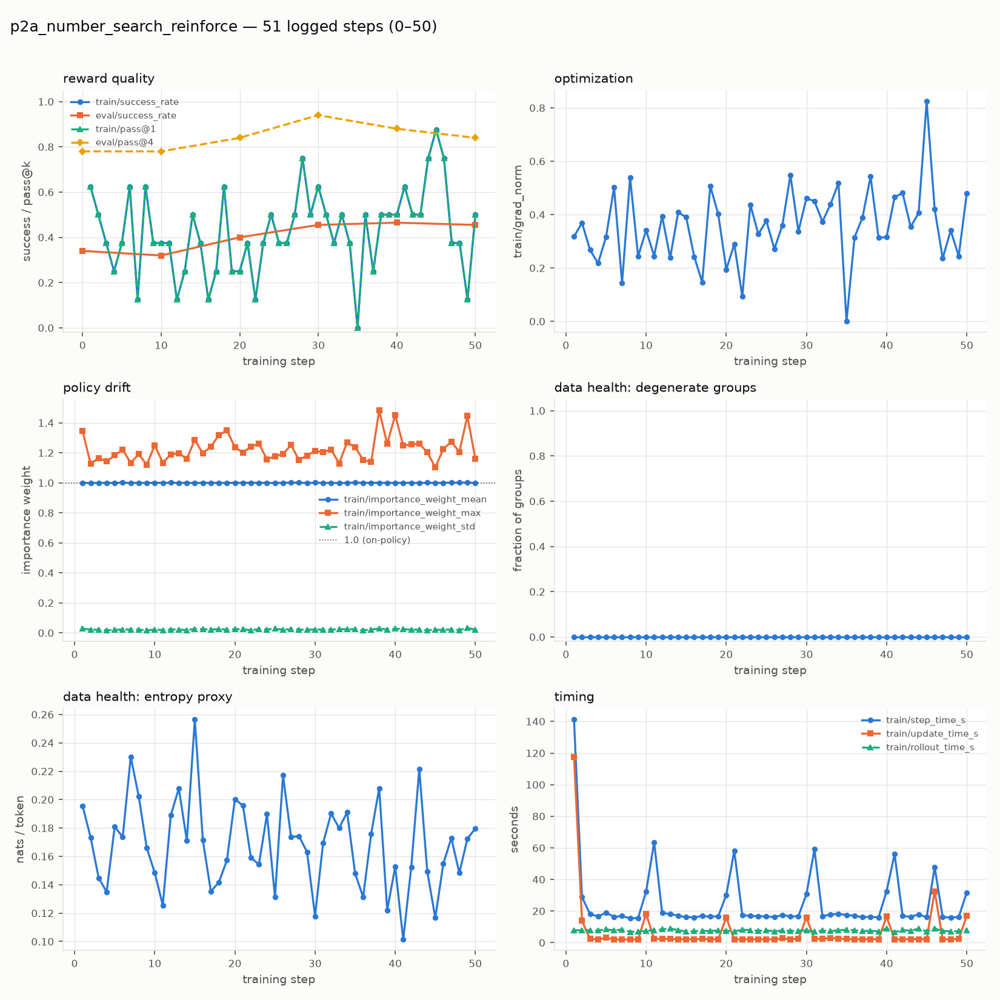
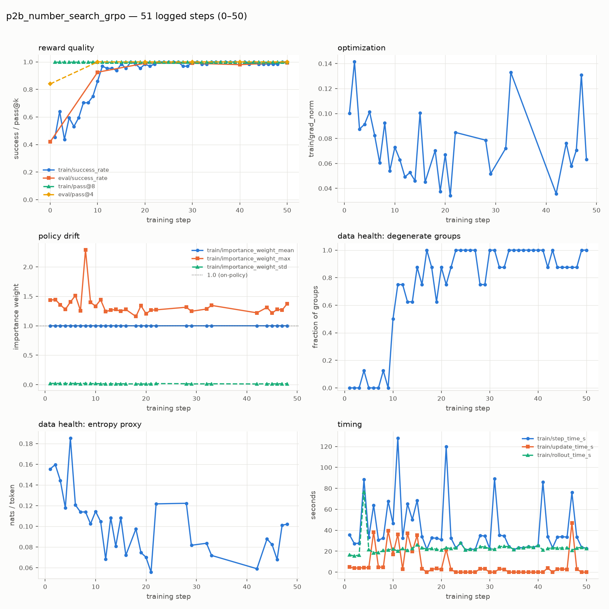
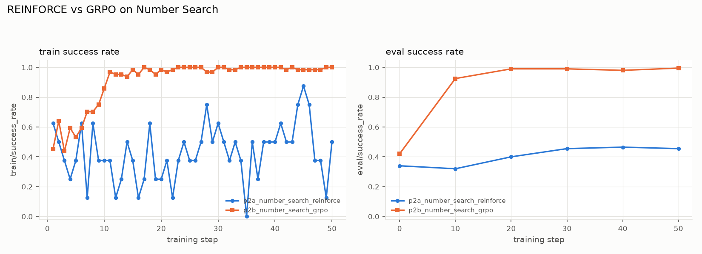

# scottyrl — Assignment 3 Report

**11-768 AI Agents, CMU, Fall 2026.**

*This report is written to be read by a generalist: every section states what was
done, shows the evidence (plots/tables), and explains what the evidence means in
plain terms before drawing conclusions.*

---

## Part 2: Synchronous REINFORCE and GRPO

### What we built and why

The trainer alternates two phases. First it **collects rollouts**: the agent
plays the task against the environment, one episode per task, using the current
policy. Then it **updates** the policy from those episodes and refreshes the
sampling policy so the next batch is on-policy.

The same loop implements both algorithms; the only difference is one line of
math that decides how much each episode is worth:

- **REINFORCE** (`p2a`, 1 rollout per task) uses the raw episode reward as the
  advantage: $A = r$. A success is reinforced, a failure contributes nothing.
  It is unbiased but noisy, because every task is judged on a single coin flip.
- **GRPO** (`p2b`, 8 rollouts per task) compares each rollout to the other
  rollouts of the *same task*: $A_i = r_i - \frac{1}{G}\sum_k r_k$. The group
  mean acts as a baseline, so easy and hard tasks cancel out and only
  "better than my usual attempt" is reinforced. When all $G$ rewards are
  identical there is no signal at all; we call that a *degenerate* group and skip
  it entirely. Following Dr.GRPO we do not divide by the group's standard
  deviation, which avoids up-weighting changes on tasks where the policy is
  nearly deterministic.

The token-level mask matters as much as the advantage: only tokens the policy
itself sampled are trained on, so the model learns to *act* rather than to
predict the environment's replies.

### Setup

Both runs use the provided configs unchanged, on the `serve_number_search_sync`
deployment: Qwen3.5-4B with a rank-32 LoRA adapter, 50 optimizer steps, 8 tasks
per step, and an evaluation every 10 steps on 50 held-out tasks with 4 rollouts
each. `p2a` uses the unclipped `importance_sampling` loss; `p2b` uses clipped
`ppo`. A 10-step probe run was done first and checked out (real transcripts,
importance weights ≈ 1.0, no sanity warnings).

### Results

Every panel below plots a metric against training step, as the handout
specifies. Each pass@ curve is labelled with its exact logged key, because
training and evaluation use different values of *k* and are different
quantities.

#### p2a — REINFORCE (1 rollout per task)

#### p2b — GRPO (8 rollouts per task)

#### Side by side

| | p2a REINFORCE (G=1) | p2b GRPO (G=8) |
|---|---|---|
| Eval success rate, step 0 → 50 | 0.34 → 0.46 | 0.42 → 1.00 |
| Eval success rate at step 10 | 0.32 | 0.93 |
| Eval `pass@4`, step 0 → 50 | 0.78 → 0.84 | 0.84 → 1.00 |
| Train success rate, steps 40–49 mean | 0.54 | 0.99 |
| Mean `train/grad_norm` | 0.36 | 0.07 |
| `train/entropy_proxy`, first → last step | 0.195 → 0.180 | 0.155 → 0.102 |
| Steps with nothing to train on | 0 of 50 | 19 of 50 (all rewards identical) |
| Mean importance weight | 1.000 | 1.000 |
| Wall-clock for 50 steps | 21.5 min | 35.0 min |

### What the evidence means

**The pipeline is correct.** In both runs the importance weight sits at exactly
1.000 (the mean-ratio panel in each drift plot). That is the fingerprint of
synchronous on-policy training: every batch was sampled by the very policy that
then trained on it. If sampled log-probabilities were attached to the wrong
tokens this number would drift away from 1.0, so this is the cleanest available
check that the masking and log-prob alignment work. No episodes were abandoned
in either run, and the p2a run never had a batch with nothing to learn from.

**GRPO learns much faster and much further.** It goes from 42% to 93% held-out
success in the first 10 steps and reaches ~99% by step 20, while REINFORCE only
creeps from 34% to about 46% over all 50 steps. The train-time curves agree:
GRPO's mean train success rate in the last ten steps is 0.99, versus 0.54 for
REINFORCE, which still oscillates between roughly 0.1 and 0.9 from batch to
batch. Note that `pass@4` for REINFORCE (0.84) is far above its `success_rate`
(0.46): the policy *can* solve the task, it just does so unreliably, which is
exactly the variance a baseline is supposed to remove.

**Is that difference expected? Yes, and for a concrete reason.** In Number
Search a task is either solved or not, so a reward is 0 or 1. Under REINFORCE
the advantage is that sparse number itself, so a failed episode contributes no
gradient at all, and a successful one is reinforced regardless of whether the
policy usually solves that task already. GRPO instead uses the other seven
rollouts on the *same* task as a control. A hard task where one rollout in eight
succeeds produces one strongly positive and seven negative advantages, whereas
an easy task where all eight succeed produces none. The estimator is therefore
far less noisy at the same number of update steps — it spends its gradient
budget where there is still something to learn. This is the textbook motivation
for GRPO, and the handout predicts it.

**Two secondary observations.** First, GRPO's gradient norm is much smaller
(0.07 vs 0.36) and its entropy proxy falls further (0.155 → 0.102). The smaller
gradient is expected because centering removes the large positive rewards that
dominate an uncentered REINFORCE gradient; the sharper entropy drop is the
policy becoming confident as it masters the task. Second, GRPO's efficiency
shows up as *degeneracy*, not as a bug: from step 17 onward most groups have all
eight rollouts succeeding, so they are correctly skipped. The data-health panel
climbs to 1.0 and 19 of 50 steps have no training examples at all. That is the
expected end state once a task is solved — there is simply nothing left to learn
from it — and it also means the late `p2b` eval plateau at ~99% is real rather
than a stalled run. The `[sanity]` warnings the framework printed about
degenerate groups are therefore benign here; they would be a real problem only
if they appeared *early*, before the task was solved.

**Cost.** GRPO costs about 1.6× more wall-clock per step here (35 vs 21.5 min for
50 steps) because it samples eight times as many episodes per task (7,644 action
tokens per step vs 845). It is still the better buy: it reaches in 10 steps a
success rate REINFORCE never approaches in 50.

---

## Part 3: Asynchronous GRPO

*To be filled in once the run completes.*
